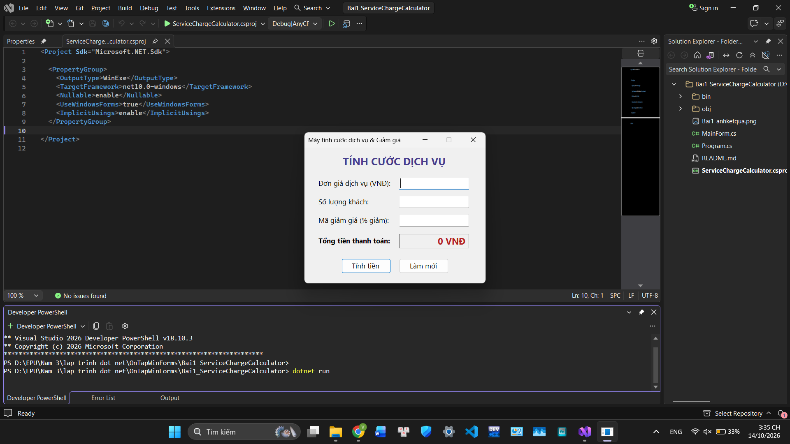
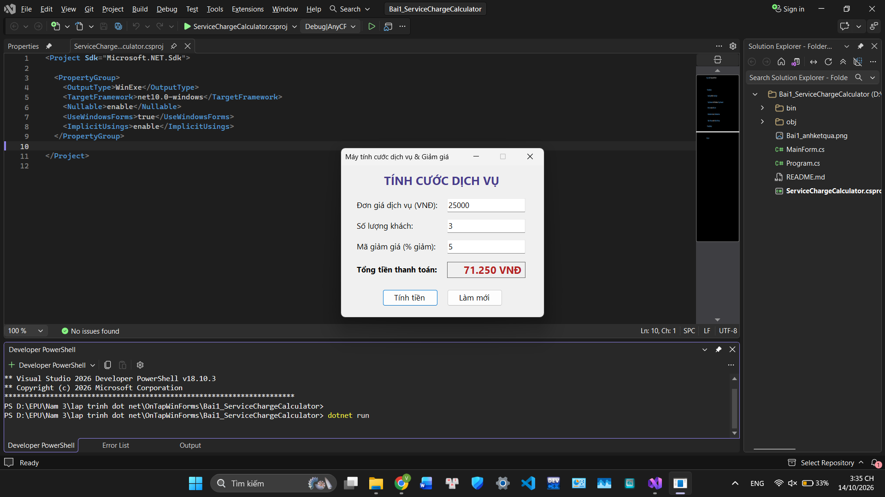
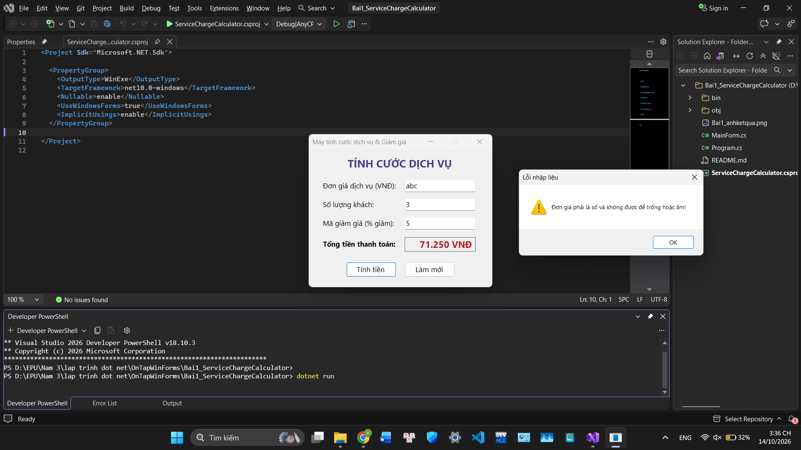
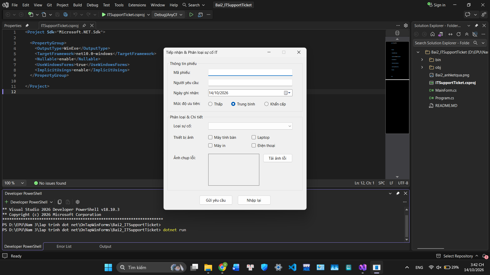
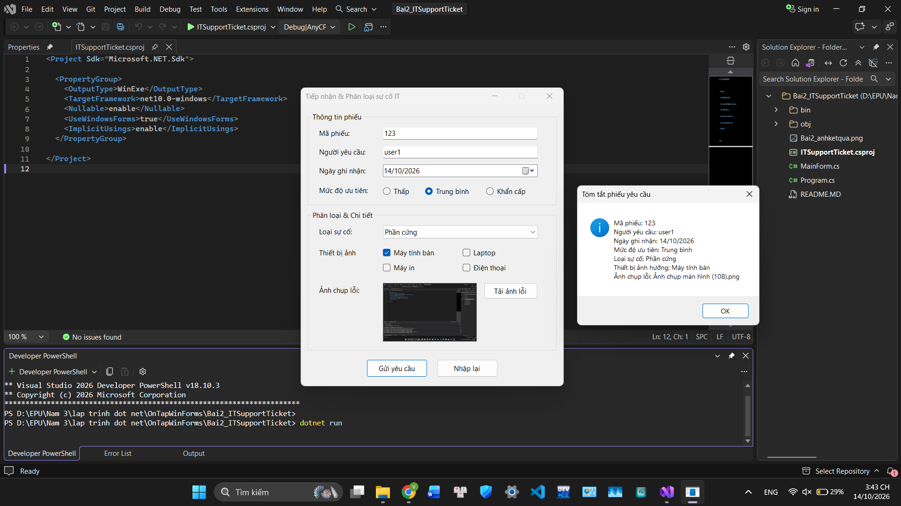
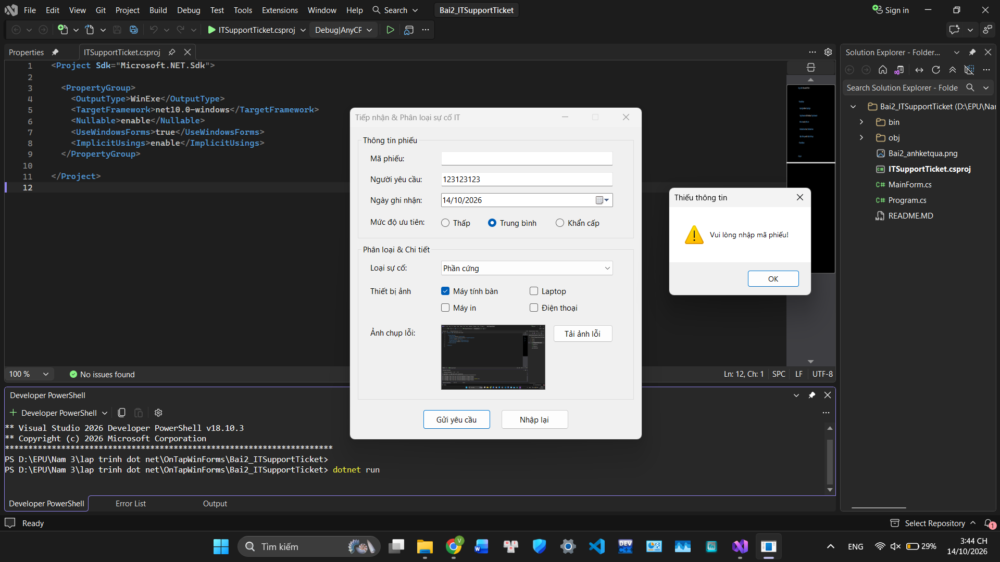
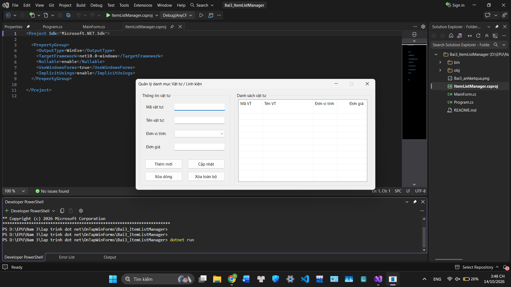
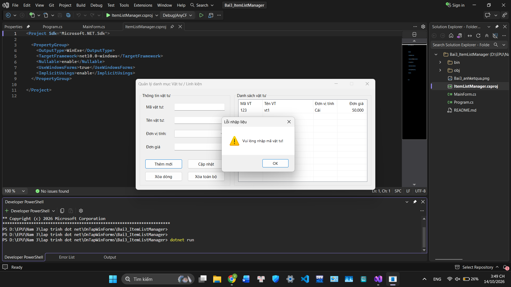

# BÁO CÁO BÀI TẬP / ĐỒ ÁN

## THÔNG TIN SINH VIÊN
- **Họ và tên:** [Đỗ Việt Hoàng]
- **Mã số sinh viên:** [24810310199]
- **Lớp:** [D19CNPM3]
- **Tên môn học:** Lập trình .NET / Windows Forms
- **Tên bài tập:** Ôn tập Window Form (Bài 1, Bài 2, Bài 3)

---

## CẤU TRÚC THƯ MỤC
| Bài | Tên bài | Thư mục mã nguồn |
|-----|---------|------------------|
| 1 | Máy tính tính cước dịch vụ & Giảm giá | `Bai1_ServiceChargeCalculator` |
| 2 | Form Tiếp nhận & Phân loại sự cố IT | `Bai2_ITSupportTicket` |
| 3 | Quản lý danh mục Vật tư / Linh kiện | `Bai3_ItemListManager` |

**Cách chạy:** cài .NET SDK 10, mở Terminal tại thư mục của bài cần chạy rồi gõ `dotnet run`.

---

## KẾT QUẢ THỰC HÀNH

## BÀI 1: MÁY TÍNH TÍNH CƯỚC DỊCH VỤ & GIẢM GIÁ

### 1. Ảnh màn hình Giao diện chính

### 2. Ảnh màn hình Chức năng thực thi / Kết quả

### 3. Ảnh màn hình Kiểm tra lỗi (Validation)

---

## BÀI 2: FORM TIẾP NHẬN & PHÂN LOẠI SỰ CỐ IT

### 1. Ảnh màn hình Giao diện chính

### 2. Ảnh màn hình Chức năng thực thi / Kết quả

### 3. Ảnh màn hình Kiểm tra lỗi (Validation)

---

## BÀI 3: QUẢN LÝ DANH MỤC VẬT TƯ / LINH KIỆN

### 1. Ảnh màn hình Giao diện chính

### 2. Ảnh màn hình Chức năng thực thi / Kết quả

### 3. Ảnh màn hình Kiểm tra lỗi (Validation)

